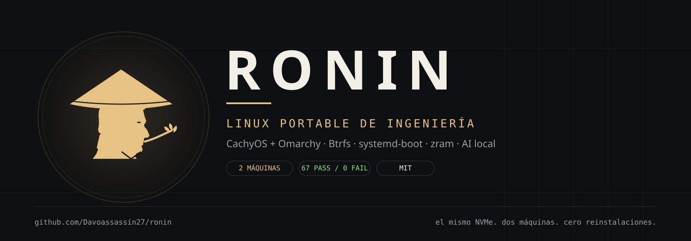

# Ronin — Linux portable de ingeniería

**Un solo NVMe. Dos máquinas. Cero reinstalaciones.** Ronin es un Linux portable basado en **CachyOS + Omarchy** que detecta el hardware en cada arranque, elige el perfil correcto y deja evidencia de cada cambio.

[](LICENSE)
[](LICENSE-DOCS)
[](#verificación-en-hardware-real)
[](https://cachyos.org)
[](https://omarchy.org)

El repositorio no es una lista de comandos: es la cadena completa y versionada para construir la imagen en QEMU, provisionarla, verificarla, migrarla a un NVMe y actualizarla.

## Por qué Ronin

- **Portable de verdad.** El mismo disco arranca en una notebook Dell y en una desktop Gigabyte; `hw-adapt.service` cambia energía y GPU según el chasis, sin intervención.
- **Reproducible.** ISO con hash fijado, `pacstrap` no interactivo, subvolúmenes Btrfs, `systemd-boot` extraíble e initramfs universal.
- **Verificado.** 67 chequeos automáticos de boot, discos, red, servicios, seguridad y UX. El resultado se guarda en JSON.
- **AI local incluida.** Ollama, Vulkan y [Kensei](https://github.com/Davoassassin27/kensei), el agente de terminal con guard de alcance y auditoría.
- **Gaming opcional.** Steam, gamemode, MangoHud y lib32, sin servicios despiertos al pedo.
- **Trazable.** Cada fallo de montaje o de uso queda en `/var/log/ronin/ux-trace.jsonl`.

> [!IMPORTANT]
> **MVP validado en hardware real.** Última corrida en la Dell Inspiron 15 3525: **67 PASS / 0 WARN / 0 FAIL**, kernel `7.3.5-2-cachyos`, 0 updates y 0 migraciones pendientes. El mismo NVMe también arrancó nativo en la desktop **Gigabyte B450M DS3H-CF** con `mode=desktop` y `profile=performance`.


## Inicio rápido

Probado en Windows 10/11 x64 con QEMU. Necesitás virtualización, ~140 GB libres y 32 GB de RAM recomendados.

```powershell
git clone https://github.com/Davoassassin27/ronin.git
cd ronin

.\build.ps1 doctor        # diagnóstico del host
.\build.ps1 fetch-iso     # descarga y verifica la ISO de CachyOS
.\build.ps1 image         # disco crudo de 120 GiB + NVRAM UEFI
.\build.ps1 up-iso        # arranca la ISO en QEMU
```

Con la ISO arriba, habilitá SSH dentro del guest (`systemctl start sshd` + `passwd root`) y desde el host:

```powershell
.\build.ps1 push          # copia scripts y configuración
.\build.ps1 provision     # ejecuta la instalación completa
.\build.ps1 verify        # suite de aceptación
```

La guía paso a paso, con los puntos de decisión y la migración al NVMe, está en [docs/02-RUNBOOK-BUILD.md](docs/02-RUNBOOK-BUILD.md) y [docs/03-RUNBOOK-MIGRATION.md](docs/03-RUNBOOK-MIGRATION.md).

## Verificación en hardware real

| Máquina | Modo detectado | Perfil | Resultado |
| --- | --- | --- | --- |
| Dell Inspiron 15 3525 | `laptop` | `balanced` · GPU AMD | **67 PASS / 0 WARN / 0 FAIL** · [JSON](reports/verify-ronin-final-20261123.json) |
| Gigabyte B450M DS3H-CF | `desktop` | `performance` · GPU AMD | Boot nativo + cambio de board · [log](reports/hw-adapt-log-portability-20261124.txt) |
| QEMU (ensayo de migración) | `desktop` | `performance` | 61 PASS / 3 WARN / 0 FAIL · [evidencia](reports/verify-migrated-final.json) |

El ensayo de migración de punta a punta está documentado en [reports/migration-rehearsal.md](reports/migration-rehearsal.md). La matriz de aceptación completa vive en [docs/04-VERIFICATION.md](docs/04-VERIFICATION.md).

## Cómo se adapta

1. **Boot:** `systemd-boot` carga un initramfs universal con los módulos de ambas máquinas.
2. **Detección:** `hw-adapt.service` lee DMI, GPU y chasis; compara con el último board visto.
3. **Aplicación:** activa `laptop/balanced` o `desktop/performance`, ajusta GPU, audio y red.
4. **Registro:** escribe el resultado en `/var/log/hw-adapt-last.json` y `/var/log/hw-adapt.log`.

## Kensei: el agente de terminal

**Kensei** es el proyecto hermano: un SLM local que opera la terminal con un bucle `observar → proponer → ejecutar → verificar`, guard de alcance, auditoría y RAG documental. Ronin lo integra con `build/guest/65-kensei.sh` y descarga el modelo en el primer boot.

- Repositorio: **[Davoassassin27/kensei](https://github.com/Davoassassin27/kensei)**
- Modelo base: Qwen2.5-Coder-7B-Instruct, cuantizado para Ollama.
- El scope arranca en `authorized: false`; hay que configurarlo y ejecutar con `--execute`.

## Actualizaciones

```bash
ronin update          # wrapper de marca sobre omarchy update
systemctl --user status ronin-update-check.timer
```

El chequeo corre a diario y **no aplica updates solo**. El detalle está en [docs/09-UPDATES.md](docs/09-UPDATES.md).

## Mapa del repositorio

```text
build.ps1                 CLI del host (PowerShell 5.1+)
build/
  build.env               parámetros versionados (sin secretos)
  iso/                    ISO (ignorada por git)
  config/                 archivos que se instalan en el guest
  scripts/host/           diagnóstico, QEMU, ISO, imagen, SSH
  guest/                  particionado, pacstrap, configuración, stack, verificación
docs/                     arquitectura, runbooks, ADRs, riesgos, updates
tests/                    lint, unit tests y trazabilidad
brand/                    marca oficial (SVG/PNG, iconos, paleta)
reports/                  evidencia de verificación publicada
```

Kensei vive en su propio repositorio. El build lo detecta si está clonado en `kensei/`; si no, lo clona desde GitHub durante el provisioning (`KENSEI_REPO` y `KENSEI_REF` en `build/build.env`).

## Seguridad

- El MVP **no incluye cifrado de disco**. Es una decisión consciente y pendiente: ver [ADR-007](docs/05-ADRS.md#adr-007-sin-cifrado-de-disco-en-el-mvp).
- UFW activo, SSH root deshabilitado, `usbcore.autosuspend=-1` y sysctl endurecido.
- Sin credenciales, claves privadas ni datos personales en el repositorio.
- Kensei bloquea comandos destructivos y objetivos fuera de su scope; cada tool-call se audita.

## Documentación

| Documento | Para qué |
| --- | --- |
| [PROJECT.md](PROJECT.md) | especificación funcional original |
| [docs/00-ROADMAP.md](docs/00-ROADMAP.md) | fases F0 → MVP y criterios de salida |
| [docs/01-ARCHITECTURE.md](docs/01-ARCHITECTURE.md) | particiones, subvolúmenes, boot y flujos |
| [docs/04-VERIFICATION.md](docs/04-VERIFICATION.md) | matriz de aceptación |
| [docs/05-ADRS.md](docs/05-ADRS.md) | decisiones de arquitectura |
| [docs/08-BUILD-LOG.md](docs/08-BUILD-LOG.md) | bitácora de la construcción real |
| [docs/09-UPDATES.md](docs/09-UPDATES.md) | updates y chequeo diario |

## Contribuir

- Abrí un issue con la máquina, el kernel y el JSON de verificación (sin datos personales).
- Para cambios de build, corré `tests/lint.ps1` y `tests/lint.sh`; si cambia la matriz, actualizá [docs/04-VERIFICATION.md](docs/04-VERIFICATION.md).
- No incluyas credenciales, claves privadas, discos crudos ni pesos de modelos.

## Licencia

- **Código:** [MIT](LICENSE).
- **Documentación y marca:** [CC BY 4.0](LICENSE-DOCS).
- **Componentes upstream:** ver [NOTICE](NOTICE).
- **Kensei:** código MIT; corpus, datasets y pesos tienen licencias propias y no se distribuyen desde este repositorio.

La marca Ronin usa una silueta de perfil basada en una imagen **CC0** del Met Museum; el wallpaper ukiyo-e es de dominio público. Atribuciones completas en [brand/README.md](brand/README.md).

Mantenido por [@Davoassassin27](https://github.com/Davoassassin27).
